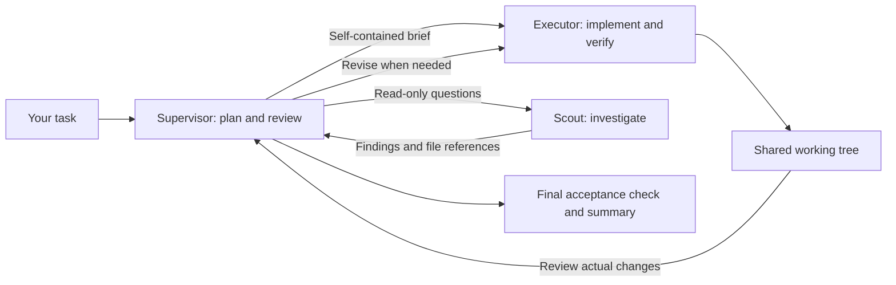

# Fusion for Pi and OpenCode

Plan with a supervisor. Delegate implementation to an executor. Review the actual changes before finishing.

Fusion runs as a **Pi extension** or an **OpenCode plugin**. Each agent has its own conversation and works in the same project directory.

## How it works



## What you get

- **Separate roles:** the supervisor plans and reviews; the executor edits and runs checks.
- **Independent model choices:** use a stronger supervisor and a cheaper executor. The scout uses the executor model.
- **Read-only scouting:** investigate the codebase without filling the supervisor's context with search output.
- **Review based on evidence:** structured worker reports, actual Git changes, check results, and blockers.
- **Bounded revisions:** up to three revisions and one final fix before the closing summary.
- **Visibility:** run status, token/cost accounting, and Pi progress displays. Missing usage is reported as incomplete.
- **Recovery controls:** persisted run records and workspace ownership guard against conflicting work after an interruption.

| | Pi | OpenCode |
| --- | --- | --- |
| Worker runtime | Pi SDK sessions; optional Durable backend | Native subagent sessions |
| Model selection | Price-tiered picker and curated model cohort | Host catalog through `fusion_configure` |
| Start a task | `/fusion <task>` | `/fusion-run <task>` |
| Persistent mode | `/fusion-mode` toggle | `/fusion-mode on` / `off` |
| Dependencies | Compatible Pi host packages | No Pi SDK dependencies |

## Installation

### OpenCode quick start

Use OpenCode **2.2.3–2.2.5** and Bun. To get an installable package:

1. Open this repository's **Actions → Package OpenCode plugin** workflow.
2. Select **Run workflow**, or open a successful run for a `v*` tag or relevant pull request.
3. Download the `fusion-opencode-<commit>` artifact and extract it. It contains
   `pi-fusion-extension-<version>.tgz` and `SHA256SUMS`.

Verify the download from its extracted directory (`shasum -a 256 -c SHA256SUMS`
on macOS, or `sha256sum -c SHA256SUMS` on Linux). Then install in your project,
replacing the tarball path with your download:

```sh
cd /path/to/your/project
bun add /path/to/pi-fusion-extension-0.1.0.tgz
mkdir -p .opencode/plugins .opencode/agents
printf '%s\n' 'export { default } from "pi-fusion-extension/opencode";' > .opencode/plugins/fusion.ts
cp node_modules/pi-fusion-extension/examples/opencode/agents/*.md .opencode/agents/
```

Restart OpenCode in that project. Configure your provider credentials through
OpenCode, then try:

```text
/fusion-run Implement a small improvement and verify it with the relevant checks.
/fusion-status
/fusion-stats
/fusion-clean
```

`/fusion-run` starts the Fusion supervisor, which delegates to the executor and
reviews its work. Ask the supervisor to call `fusion_configure` to select an
executor provider/model; the scout uses that model too. OpenCode uses
`/fusion-mode on` and `/fusion-mode off` for persistent mode. After an
interruption, use `/fusion-resume` and follow its recovery instructions.

The OpenCode entry installs no Pi SDK dependencies. The workflow uploads a
package artifact; it does not publish to npm or create a GitHub release.
For local packaging, run `npm pack` from this repository and install the
resulting tarball using the same steps. See the [operating guide](docs/install.md)
for gateway credentials, shared ownership configuration, and recovery limits.

### Pi project-local development

Clone or copy this repository and launch `pi` from the repository root. Pi auto-discovers `.pi/extensions/fusion.ts` after the project is trusted, and that file loads `src/index.ts`.

### Local Pi package

From the package root:

```bash
pi install ./
```

The `pi.extensions` field in `package.json` points Pi at `./src/index.ts`.

### Pi one-off

```bash
pi --extension ./src/index.ts
```

## Commands at a glance

| Goal | Pi | OpenCode |
| --- | --- | --- |
| Configure models | `/fusion-config` | Ask the supervisor to call `fusion_configure` |
| Start a task | `/fusion <task>` | `/fusion-run <task>` |
| Inspect current work | `/fusion-status` | `/fusion-status` |
| Inspect usage | `/fusion-stats [N]` | `/fusion-stats` |
| Inspect recovery options | `/fusion-resume` | `/fusion-resume` |
| Release resources after work settles | `/fusion-clean` | `/fusion-clean` |

## Know before using

- Workers edit your real working tree and run with the host's permissions. Review changes before committing.
- Pi and OpenCode processes sharing workspaces must use the same `FUSION_OWNERSHIP_DIR` (the default is `~/.local/state/fusion/ownership`).
- Recovery depends on the backend and available completion evidence. Interrupted work may need manual inspection and explicit operator resolution; commands can have side effects even when their outcome is uncertain.
- Pi Durable is experimental. Native Pi supervisor acceptance still has open cases; OpenCode restart completion delivery has an upstream limitation.
- Pi model tiers depend on catalog pricing and a maintained model-family allowlist.

See the [install and operating guide](docs/install.md) for credentials, dependency versions, configuration, and recovery. The [OpenCode readiness report](docs/opencode-testing.md) records verified behavior and remaining limitations.

## Development

```sh
bun install
bun test
bun run typecheck
bun run test:clean-install
```

| Location | Purpose |
| --- | --- |
| `src/core/` | Shared workflow, worker contracts, and run manifests |
| `src/index.ts`, `src/pi/` | Pi entrypoint and runtime adapters |
| `src/opencode/` | OpenCode plugin and native subagent adapter |
| `src/workspace/` | Git evidence and workspace ownership |
| `examples/opencode/agents/` | Supervisor, executor, and scout definitions |
| `test/` | Unit tests and opt-in native integration fixtures |
| `.github/workflows/package-opencode.yml` | Package checks and downloadable build artifacts |

Model-consuming integration checks are opt-in; commands are listed in the [operating guide](docs/install.md#verifying-your-install).

## License

MIT. Independent community project; not affiliated with Cognition or Devin.
